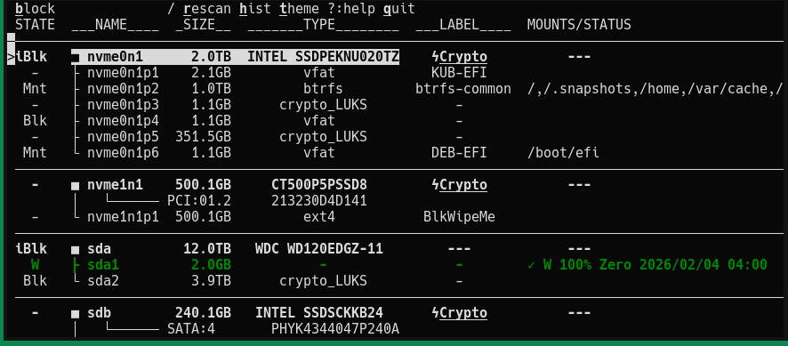

# dwipe
`dwipe` wipes disks and partitions on Linux. It aims to reduce mistakes by showing ample information about each device during selection.



## What sets it apart
Beyond `nwipe`, `shred` and `dd`:
- Firmware wipes (SATA ATA Security Erase, NVMe Sanitize/Format)
- Multiple simultaneous wipes with individual progress
- Persistent wipe state and resume of interrupted software wipes
- Hot-swap detection and per-disk blocking
- Protection for mounted and LUKS/LVM/RAID/swap-held devices
- Fast statistical verification (samples every one of 100 disk sections at any verify %)

Not a certified-destruction tool: no DoD/Gutmann pattern sequences or compliance certificates.

## Requirements
- Linux; root/sudo (requested automatically)
- Python 3.10+
- `lsblk`; `nvme-cli` for NVMe firmware wipes; `hdparm` for SATA firmware wipes
- Optional history-screen clipboard: `xclip`/`xsel` (X11), `wl-clipboard` (Wayland); SSH uses OSC 52

## Install
`pipx install dwipe` — verify with `dwipe --version`. Uninstall: `pipx uninstall dwipe`.

## Quick start
1. Run `dwipe`.
2. Select a device, press **w**, type the wipe abbreviation. Choices run least → most recommended; the recommended pick is marked `*` (HDDs are the exception: software modes come first).
3. **Drive type matters more than the drive says.** Spinning HDDs: use `Rand` or `Zero`. SSDs: use a firmware wipe when offered.
4. `Mnt` means mounted or in use (release it first); `Blk` means blocked (press **b**).
5. **Frozen** drive? Suspend and resume the system — `dwipe` rescans on resume (or press **r**).
6. **Locked** drive? Unlock it manually (below). If `dwipe` locked it, the password is `NULL`.
7. Hot-swap SATA: `DEL` to detach, swap the drive, then **r**.

Firmware wipes appear among the **w** choices only for drives that report support for them (see the FwCAPS column).

## Screen reference
Keys and options are listed by **?** and `dwipe --help`; every CLI preference is saved and reused as the default.

**STATE**: `-` ready · `^` hot-added · `Mnt` mounted/in use · `N%`/`vN%` wipe/verify progress · `STOP` stopping · `s` stopped, partially wiped · `W` wiped · `Blk` blocked · `Unbl` just unblocked.

**MOUNTS/STATUS**: a path is a real mount point; `\busy` means in use without a mount (open LUKS container, active LVM volume group, running RAID array, active swap). Both prevent wiping — release the holding layer first. A device held by dm-crypt/LVM/md/swap is protected even when it is not itself mounted.

**Actions**: `w` wipe · `v` verify · `s` stop (selected) / `S` stop all · `b` block/unblock · `DEL` detach disk · `/` regex filter · `r` rescan · `h` history · `t` themes · `?` help · `q` quit.

**Colours**: dimmed = cannot be wiped · bright = wipe/verify running · green = wiped (this session) · red = destructive prompt.

**Auto-blocking**: LUKS, LVM2, RAID members and swap are blocked the first time they are seen (`--auto-block-containers off` disables this). **b** unblocks permanently.

**History** (`h`): timestamps, device details and results; `e` expands JSON, `c` copies, `/` searches.

## Wipe types
Firmware wipes rank above software wipes and are offered only for drives that support them.

**NVMe**: `Crypto` (Sanitize Crypto Erase) → `Block` (Sanitize Block) → `FCrypto` (Format Crypto) → `FErase` (Format User Data) → `Ovwr` (Sanitize Overwrite, slow) → `Rand` → `Zero`.

**SATA SSD**: `SCrypto` → `Enhanced` (ATA Enhanced Erase) → `SBlock` → `Erase` (ATA Erase) → `SOverwrite` → `Rand` → `Zero`.

**SATA HDD**: `Rand` → `Zero` — preferred: interruptible, resumable, shows progress. `Enhanced`/`Erase` are slower, uninterruptible and equally thorough, since HDDs have no wear levelling or hidden blocks.

**Partitions / USB**: `Rand` → `Zero`.

Firmware wipes report no percentage and get an automatic spotcheck at the start, middle and end of the drive. `+V` modes auto-verify software wipes; otherwise press **v**.

## Resume
Stopped software wipes (`s`) resume with **w** using the same mode, continuing from the last marker; the current passes setting then applies. Markers are written about every 30 s, so a hard crash can lose up to ~30 s of work.

## Verification
The disk is divided into 100 sections and the configured percentage (`--verify-pct`) is sampled from each — even 1% touches the whole disk. Zeros fail at the first non-zero byte; random data is checked for uniform byte distribution with periodic fast-fail. A passing verification marks the device as wiped.

## Persistent state
Wipe status is stored in the first 16 KB of the device (15 KB zeros + 1 KB JSON), so `W`/`s` survive reboots and power loss.

## Security and compliance
- One pass of zeros is sufficient for modern (post-2001) drives; extra passes add no proven security.
- No DoD 5220.22-M or Gutmann certified sequences, so **not suitable for classified or top-secret data** or any requirement for certified destruction.
- SSDs wear-level data and may retain it in unmapped blocks; TRIM can also prevent full erasure. Prefer firmware wipes, then verify.
- Encryption is the primary defence for sensitive data.

## Troubleshooting
- `cannot find lsblk on $PATH` — install `util-linux`.
- Cannot wipe (`Mnt`/`\busy`): unmount, then release the holder — `sudo cryptsetup close <name>`, `sudo vgchange -an <vg>`, `sudo mdadm --stop /dev/mdX`, `sudo swapoff /dev/...` — and press **r**.
- Wipe stuck: **s**, then **S**; disks take minutes to time out at kernel level. If the interface is dead: Ctrl-Z, `sudo pkill -f "python.*dwipe"`, then `reset`.

## Firmware wipe notes
SATA drives are usually **frozen** by the BIOS at POST. Suspend/resume clears it; if not, power off for 10+ minutes.

Erase support is never guaranteed: some drives do not implement sanitize correctly or time out. `dwipe` cannot guarantee a successful wipe on non-compliant hardware — always press **v** afterwards and use vendor tools for critical data on quirky drives.

Repeated write errors, stalls (5 min) and slowdowns abort the wipe, leaving state `s`. If errors persist, the disk is likely failing.

**SATA over USB** needs SAT passthrough (the drive's "Security" section must be visible), a powered dock for 3.5" drives (under-voltage can brick a drive mid-erase) and a bridge without an aggressive watchdog (ASMedia 1153E, JMicron JMS578).

**Unlock a locked drive**:
```
sudo hdparm --user-master u --security-unlock NULL /dev/sdX
sudo hdparm --user-master u --security-disable NULL /dev/sdX
```

## Issues
Report at [github.com/joedefen/dwipe](https://github.com/joedefen/dwipe).

## License
MIT — see [LICENSE](LICENSE).
